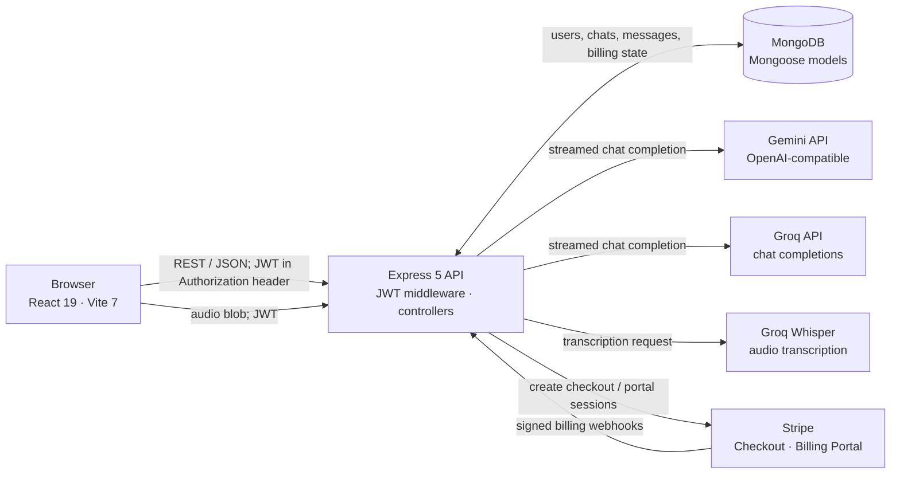
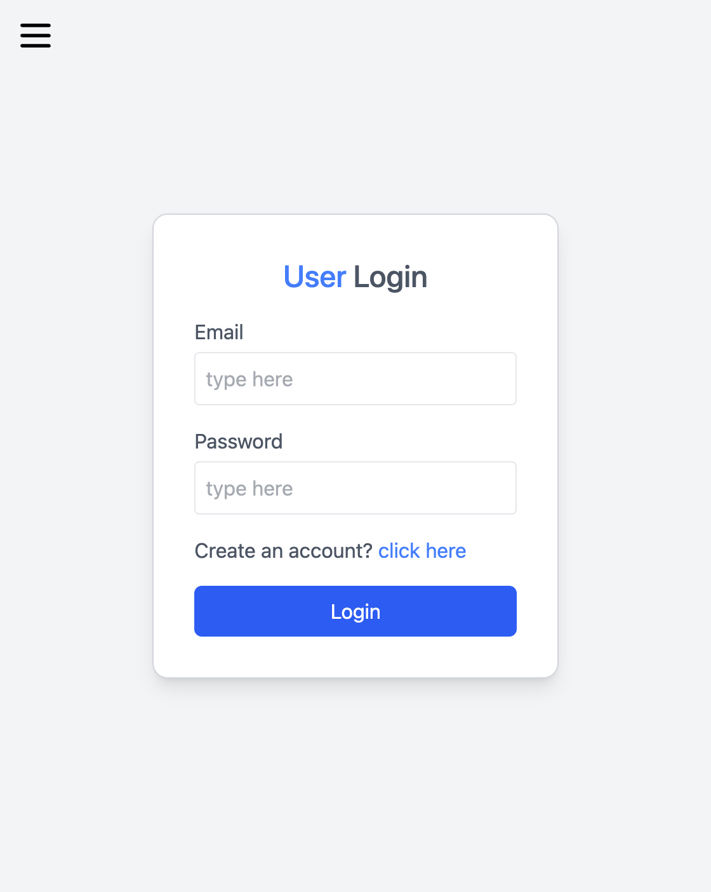
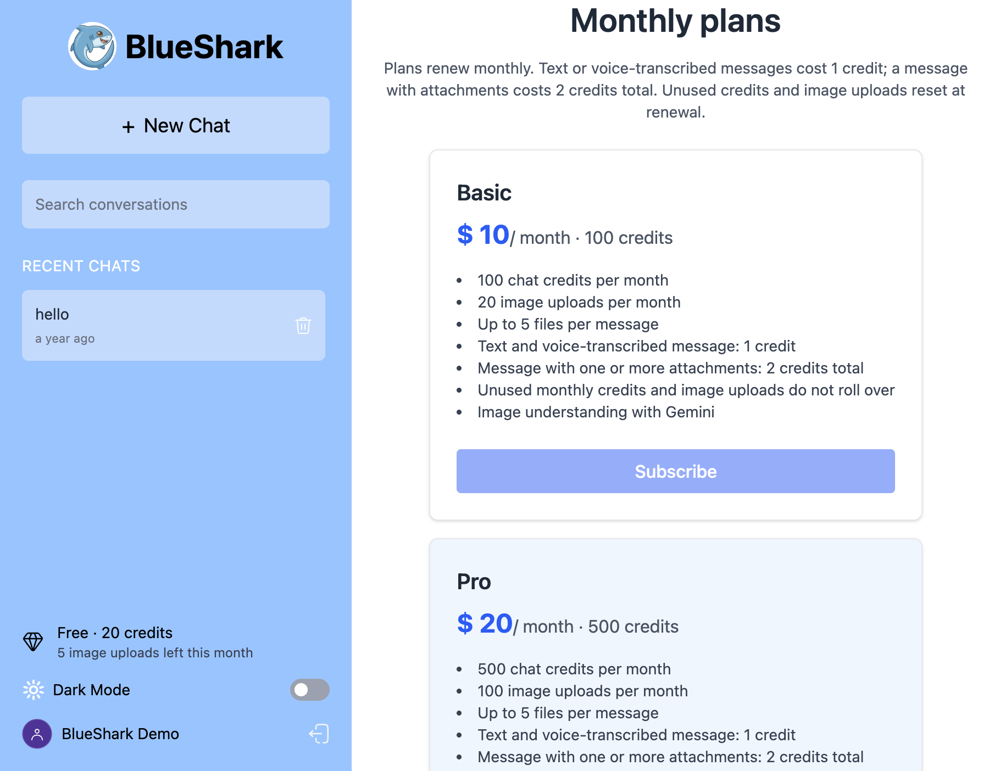
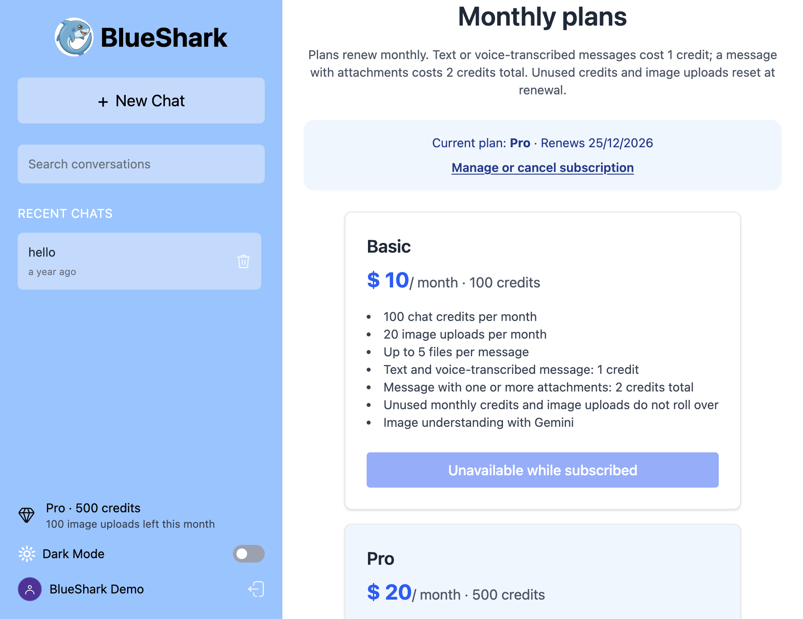
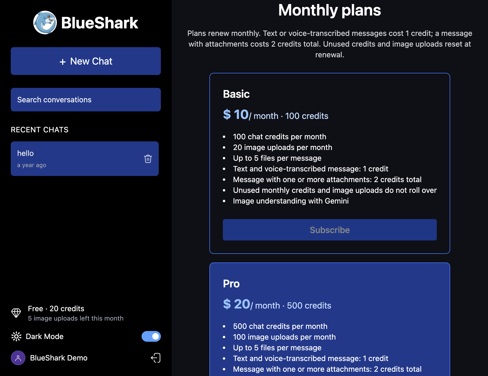

# BlueShark

### A full-stack AI chat application for persistent conversations, voice input, and multimodal prompts.

**Author:** Chetna Singh

[](https://react.dev/)
[](https://vite.dev/)
[](https://tailwindcss.com/)
[](https://reactrouter.com/)
[](https://axios-http.com/)
[](https://expressjs.com/)
[](https://mongoosejs.com/)
[](https://github.com/openai/openai-node)
[](https://www.npmjs.com/package/bcryptjs)
[](https://stripe.com/)


> **Portfolio status:** This repository contains local-development and Vercel deployment configuration. No live deployment URL or demo account is configured here.

## Overview

BlueShark is a MERN-style AI chat product built with a React/Vite client and an Express API backed by MongoDB and Mongoose. Users can register, sign in, maintain separate conversations, and choose a Gemini-compatible or Groq chat provider. The app also supports browser-recorded voice prompts transcribed through Groq Whisper, image and document attachments, and monthly plans billed through Stripe.

## Key features

- **Authentication:** Register and log in with email/password. Passwords are hashed with `bcryptjs`; the API issues a 30-day JWT used by protected routes.
- **Saved chats:** Create, list, search, select, and delete conversations. Chat messages and attachment metadata are stored with each chat.
- **Streaming AI responses:** Stream chat completions from Gemini (through its OpenAI-compatible API) or Groq. The provider selection is remembered in browser local storage.
- **Attachments and image understanding:** Attach up to five files per message. Text-based formats are included in the prompt; image understanding is supported with Gemini for JPEG, PNG, and WebP data URLs. Camera capture is available in supported browsers.
- **Voice input:** Record audio in the browser, stop manually or after a pause, and transcribe with Groq Whisper (`whisper-large-v3-turbo`). English and Hinglish are supported by the transcription prompt.
- **Credits and subscriptions:** Free, Basic, Pro, and Premium usage allowances are checked by the API. Stripe Checkout and Billing Portal support recurring subscriptions and cancellation. Paid credits renew on verified paid invoices; scheduling a cancellation stops future renewal and immediately switches the account to the Free allowance while retaining the Stripe subscription record until the paid period ends.
- **Responsive interface:** Conversation search, mobile navigation, light/dark theme, Markdown-rendered assistant responses, and syntax highlighting.
- **Development preview:** `VITE_DEMO_MODE=true` provides local sample data in Vite development mode. It is not a backend-connected or payment-enabled demo.

## Architecture and data flow



## Database schema

Mongoose creates the `users` and `chats` collections. Both schemas enable `createdAt` and `updatedAt` timestamps.

| Collection / model | Key fields | Relationships and notes |
| --- | --- | --- |
| `User` | `name`, `email`, `password`, `credits`, `planId`, `subscriptionId`, `subscriptionPlanId`, `stripeCustomerId`, `subscriptionStatus`, `subscriptionCancelAtPeriodEnd`, `billingPeriodStart`, `billingPeriodEnd`, `imageUploadsThisPeriod`, `imageUsagePeriodStart`, `lastPaidInvoiceId` | MongoDB `_id` is the user's ObjectId. `email` is required and marked `unique`. Passwords are hashed before save. `planId` is one of `free`, `basic`, `pro`, or `premium`; `subscriptionPlanId` retains the purchased tier when cancellation immediately switches `planId` to `free`. |
| `Chat` | `userId`, `userName`, `name`, `messages[]` | MongoDB `_id` is the chat ObjectId. `userId` is declared as a **String** with `ref: "User"` (not an ObjectId-typed reference); the controller stores the owning user's ID as a string. |
| `Chat.messages[]` (embedded) | `content`, `role`, `timestamp`, `attachments[]` | Embedded messages have no separate collection. Each attachment can store `name`, `type`, and extracted `text`. Image data and recorded audio are not persisted by the API. |

## API reference

The backend listens on port `3000` by default. Protected endpoints expect the JWT directly in the `Authorization` header (without a `Bearer` prefix). The Stripe webhook endpoint instead authenticates requests using Stripe's signature header and the configured webhook secret.

| Method | Endpoint | Auth Required | Description |
| --- | --- | --- | --- |
| `GET` | `/` | No | Basic API liveness response. |
| `POST` | `/api/user/register` | No | Create an account and return a JWT. Body: `name`, `email`, `password`. |
| `POST` | `/api/user/login` | No | Verify credentials and return a JWT. Body: `email`, `password`. |
| `GET` | `/api/user/data` | JWT | Return the authenticated user's account data. |
| `GET` | `/api/chat/create` | JWT | Create a new empty conversation. |
| `GET` | `/api/chat/getchats` | JWT | List the authenticated user's conversations, newest-updated first. |
| `POST` | `/api/chat/delete` | JWT | Delete an owned conversation. Body: `chatId`. |
| `POST` | `/api/message/text` | JWT | Submit a prompt, provider, and optional attachments; returns newline-delimited JSON response chunks and final usage data. |
| `POST` | `/api/message/transcribe` | JWT | Transcribe a raw audio request body using Groq Whisper. Audio request limit: 10 MB. |
| `GET` | `/api/credit/plan` | No | Return the available subscription plan definitions and features. |
| `GET` | `/api/credit/subscription-status` | JWT | Refresh the current subscription state and cancellation date directly from Stripe. |
| `POST` | `/api/credit/purchase` | JWT | Create a Stripe Checkout subscription session. Body: `planId`. |
| `GET` | `/api/credit/checkout-status` | JWT | Verify a Checkout session with Stripe and activate its paid plan once. Query: `sessionId`. |
| `POST` | `/api/credit/portal` | JWT | Create a Stripe Billing Portal session so the authenticated customer can manage or cancel their subscription. |
| `POST` | `/api/stripe` | Stripe signature | Receive and verify Stripe subscription and invoice webhook events. |

JSON request bodies for other API routes are limited to 20 MB. Deployment platforms may enforce lower limits.

## Environment variables

Copy the example files and replace placeholders locally. Do not commit real credentials. The backend loads `backend/.env`; Vite reads the frontend's `VITE_` variables at build/dev time.

### Backend

| Variable | Required | Description | Example |
| --- | --- | --- | --- |
| `PORT` | No | Express listening port. Defaults to `3000`. | `3000` |
| `MONGO_URI` | Yes* | MongoDB connection string. Takes precedence over `DATABASE_URL`. | `mongodb://127.0.0.1:27017/blueshark` |
| `DATABASE_URL` | Yes* | Alternative MongoDB connection-string variable when `MONGO_URI` is unset. | `mongodb+srv://<user>:<password>@<cluster>/<database>` |
| `JWT_SECRET` | Yes | Secret used to sign and verify 30-day JWTs. Use a long, unique random value. | `<long-random-secret>` |
| `GEMINI_API_KEY` | One chat provider required | Gemini API key; selects the Gemini OpenAI-compatible endpoint when present. | `<gemini-api-key>` |
| `OPENAI_API_KEY` | Alternative | API key for an OpenAI-compatible endpoint when `GEMINI_API_KEY` is not set. | `<compatible-api-key>` |
| `OPENAI_BASE_URL` | No | Overrides the Gemini/OpenAI-compatible API base URL. | `https://your-provider.example/v1` |
| `OPENAI_MODEL` | No | Model for the Gemini/OpenAI-compatible provider. Defaults to `gemini-3.5-flash-lite` with Gemini, otherwise `gpt-4o-mini`. | `gemini-3.5-flash-lite` |
| `GROQ_API_KEY` | For Groq chat and voice | Groq key for chat completions and audio transcription. | `<groq-api-key>` |
| `GROQ_BASE_URL` | No | Groq-compatible API base URL. Defaults to `https://api.groq.com/openai/v1`. | `https://api.groq.com/openai/v1` |
| `GROQ_MODEL` | No | Groq chat model. Defaults to `openai/gpt-oss-120b`. | `openai/gpt-oss-120b` |
| `STRIPE_SECRET_KEY` | For billing | Stripe secret key or a restricted key with Checkout Session and subscription read/write permissions (and Billing Portal permissions if that endpoint is used). Use a test-mode key for local testing. | `sk_test_<key>` |
| `STRIPE_WEBHOOK_SECRET` | For webhooks | Stripe webhook signing secret. | `whsec_<secret>` |
| `STRIPE_WEBHOOKS_SECRET_KEY` | Legacy alias | Accepted as a fallback if `STRIPE_WEBHOOK_SECRET` is unset. Prefer the canonical variable above. | `whsec_<secret>` |
| `FRONTEND_URL` | Required in production; optional locally | Trusted frontend origin used for Checkout and Billing Portal return URLs. In local development, a loopback browser origin (`localhost` or `127.0.0.1`) is preserved, falling back to `http://localhost:5173`; production must configure an HTTPS URL. Untrusted origins are not used. | `http://localhost:5173` |

\* Configure exactly one of `MONGO_URI` or `DATABASE_URL`. Configure `GEMINI_API_KEY` or `OPENAI_API_KEY` for Gemini-compatible chat. Groq requires `GROQ_API_KEY`; Stripe variables are needed only to enable billing and webhook processing.

### Frontend

| Variable | Required | Description | Example |
| --- | --- | --- | --- |
| `VITE_SERVER_URL` | Recommended | Backend base URL used by Axios and direct streaming/audio requests. | `http://localhost:3000` |
| `VITE_DEMO_MODE` | No | Enables sample-data preview only when set to `true` in Vite development mode. Backend actions remain disabled. | `false` |
| `DEV` | Vite-provided | Built-in Vite boolean indicating development mode; not a user-defined environment variable. Demo mode is gated by this value. | `true` during `vite dev` |

## Local setup

### Prerequisites

- Node.js compatible with Vite 7 (Node.js `20.19+` or `22.12+`) and npm.
- MongoDB locally or a reachable MongoDB deployment.
- A Gemini API key or OpenAI-compatible API key for chat.
- A Groq API key for Groq chat and voice transcription.
- Stripe test credentials and a configured Stripe webhook endpoint to test billing.

### 1. Get the code and install dependencies

Replace the repository URL with the URL for your GitHub repository:

```bash
git clone https://github.com/<your-username>/<your-repository>.git
cd <your-repository>

cd backend
npm install
cd ../frontend
npm install
cd ..
```

### 2. Configure local environment

```bash
cp backend/.env.example backend/.env
cp frontend/.env.example frontend/.env
```

Edit `backend/.env` with the MongoDB URI, a strong `JWT_SECRET`, and the provider keys you intend to use. For local Stripe tests, use Stripe test-mode credentials and set `FRONTEND_URL=http://localhost:5173`. In production, `FRONTEND_URL` must be your HTTPS frontend origin. Set `VITE_SERVER_URL` in `frontend/.env` if the API is not at `http://localhost:3000`.

### 3. Start the API and frontend

In one terminal:

```bash
cd backend
npm run server
```

In a second terminal:

```bash
cd frontend
npm run dev
```

Open the local URL printed by Vite (typically `http://localhost:5173`). The API defaults to `http://localhost:3000`.

### Stripe webhook testing

For local billing tests, use Stripe test mode, configure Stripe's Customer Portal if you enable subscription management, and use the Stripe CLI to forward the events handled by the application:

```bash
stripe listen \
  --events checkout.session.completed,invoice.paid,invoice.payment_failed,customer.subscription.updated,customer.subscription.deleted \
  --forward-to localhost:3000/api/stripe
```

Set the CLI-generated `whsec_...` secret as `STRIPE_WEBHOOK_SECRET` in `backend/.env` and restart the backend. After Checkout, the app verifies the session directly with Stripe before applying the plan; the signed `invoice.paid` webhook also handles initial and renewal entitlements. A redirect by itself is not treated as proof of payment.

### Docker and validation

No `Dockerfile` or Docker Compose file is included. Available project checks:

```bash
(cd frontend && npm run build && npm run lint)
find backend -path backend/node_modules -prune -o -name '*.js' -exec node --check {} \;
```

## Folder structure

```text
.
├── backend/
│   ├── configs/                 # MongoDB, AI providers, plan limits
│   ├── controllers/             # Users, chats, messages, voice, billing, webhooks
│   ├── middlewares/             # JWT authentication
│   ├── models/                  # User and Chat Mongoose schemas
│   ├── routes/                  # User, chat, message, and credit routers
│   ├── .env.example
│   ├── package.json
│   └── server.js
├── frontend/
│   ├── src/
│   │   ├── assets/              # Logo, icons, sample data, syntax styles
│   │   ├── components/          # Chat, sidebar, attachments, provider and voice UI
│   │   ├── config/              # Client-side plan display
│   │   ├── context/             # Shared auth, chat, theme, and API state
│   │   ├── hooks/               # Voice chat hook
│   │   ├── pages/               # Login, credits, and loading views
│   │   ├── App.jsx
│   │   └── main.jsx
│   ├── .env.example
│   ├── index.html
│   ├── package.json
│   └── vite.config.js
└── README.md
```

## Security and performance notes

- **Password storage:** `bcryptjs` hashes passwords with a generated salt before a user document is saved.
- **Route authentication:** JWTs expire after 30 days. The `protect` middleware verifies the token and loads the corresponding user for protected routes.
- **Webhook verification:** Stripe webhook payloads are read as raw bytes and verified against the Stripe signature before event handling. Paid invoice IDs are tracked to avoid applying the same invoice allowance more than once.
- **Usage enforcement:** API-side plan checks enforce credit, image, and attachment limits. Credit/image usage is reserved with a conditional MongoDB update before the AI request.
- **Payload limits:** JSON API bodies are limited to 20 MB and audio transcription bodies to 10 MB. Image data is sent inline to the AI provider and is not stored by the app.
- **Production hardening to consider:** The server uses `cors()` without an explicit origin allowlist. No Helmet or request rate-limiting middleware is configured. JWTs are stored in browser `localStorage`; review the token-storage and XSS threat model before production deployment. Configure HTTPS, restrict CORS, and add suitable rate limits and security headers for a public deployment.
- **Sensitive data handling:** Authenticated user lookups exclude the password hash, and login no longer logs user documents or credentials.
- **Database indexes:** `User.email` is marked `unique`, which Mongoose can use to create a unique MongoDB index. No other explicit schema indexes are defined.

## Demo and project links

- **Live demo:** _Add deployment URL when available._
- **Screenshot:** [`Screenshots/login.png`](Screenshots/login.png)
- **Free-plan demo:** [`Screenshots/free-plan-demo.png`](Screenshots/free-plan-demo.png)
- **Pro-plan demo:** [`Screenshots/pro-plan-demo.png`](Screenshots/pro-plan-demo.png)
- **Free-plan dark mode:** [`Screenshots/free-plan-dark-demo.png`](Screenshots/free-plan-dark-demo.png)
- **Pro-plan dark mode:** [`Screenshots/pro-plan-dark-demo.png`](Screenshots/pro-plan-dark-demo.png)
- **Test user:** _Not provided. Add a dedicated demo account only after provisioning it safely._
- **Test admin:** _No admin role or admin account is defined in this codebase._



These Free and Pro screens are local demo-state previews only. No payment was made and no real subscription was activated.

### Free plan



### Pro plan demo (simulated; no checkout)



### Dark mode




## Tech stack

| Layer | Technologies |
| --- | --- |
| Frontend | React 19, Vite 7, Tailwind CSS 4, React Router 7, Axios |
| Backend | Node.js, Express 5, Mongoose 8, `jsonwebtoken`, `bcryptjs` |
| Database | MongoDB |
| AI and voice | OpenAI SDK-compatible Gemini and Groq APIs; Groq Whisper |
| Billing | Stripe Checkout, Billing Portal, and signed webhooks |
| Developer tooling | ESLint 9, Vite, Nodemon |

## License

This project is licensed under the MIT License. See the [LICENSE](LICENSE) file for details.
